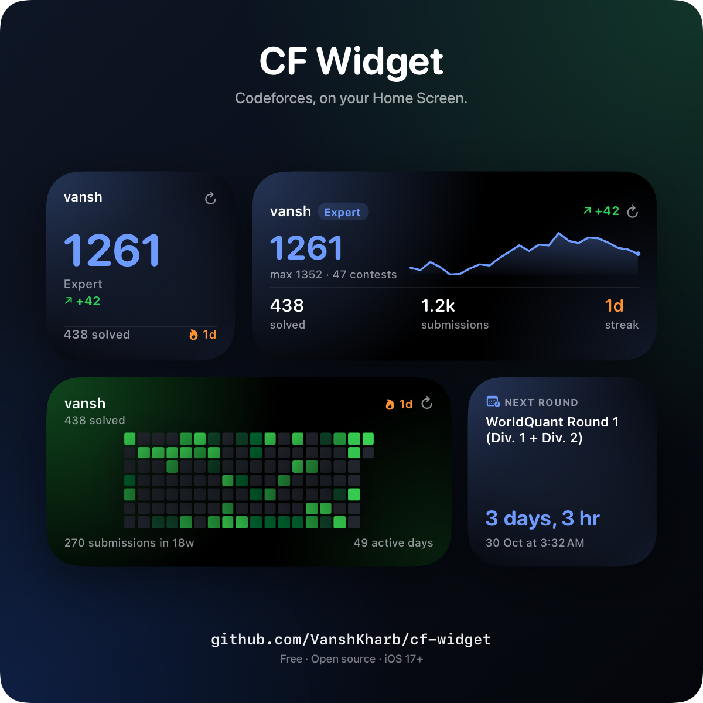

# CF Widget

A Codeforces widget for the iPhone Home Screen and Lock Screen — rating, rank,
solved count, a GitHub-style submission heatmap, a rating sparkline and upcoming
rounds with a live countdown.

Data comes from the **public Codeforces API**, so there is no login, no password
and no API key. You only need your handle.



## What you get

| Widget | Sizes | Shows |
| --- | --- | --- |
| **CF Stats** | small, medium, Lock Screen (circular / rectangular / inline) | Rating, rank, delta from the last contest, max rating, solved count, streak, rating sparkline |
| **CF Heatmap** | medium, large | 18 or 26 weeks of submission activity, current and longest streak, active days. The large size adds a submissions-per-week bar chart. |
| **CF Contests** | small, medium | Next round with an auto-updating countdown, duration, and the two rounds after it |

Plus a companion app that does the heavy lifting and shows your full dashboard:
rating chart with axes, 26-week heatmap with a legend, activity breakdown and the
upcoming contest list.

## Requirements

- macOS with **full Xcode** (the widget extension cannot be built with Command
  Line Tools alone — `xcode-select -p` must point at Xcode)
- [XcodeGen](https://github.com/yonaskolb/XcodeGen): `brew install xcodegen`
- An iPhone or iPad on **iOS 17.0+**, or a simulator
- An Apple ID. A free *Personal Team* is enough — mind
  [the 7-day catch](#the-7-day-catch)

## Build it yourself

```bash
git clone <this-repo> cf-widget
cd cf-widget
brew install xcodegen      # skip if you already have it
./Tools/setup.sh           # asks for your Team ID and a bundle prefix
open CFWidget.xcodeproj
```

`setup.sh` writes `Config/Identity.xcconfig` (gitignored) with your Team ID,
bundle prefix and App Group ID, then generates the project. Nothing in the source
is tied to the original author, so two people can build this side by side.

Then in Xcode:

1. Pick an iPhone simulator (or your iPhone) and press **⌘R**.
2. Type your Codeforces handle and tap **Refresh stats**. The first run scans up
   to 10,000 submissions (a few seconds) so the solved count is exact.
3. Home Screen → touch and hold an empty area → **Edit** → **Add Widget** →
   search **CF Widget**.

You'll find your Team ID in Xcode → **Settings → Accounts** (the 10-character
code next to your name).

The widget reads the snapshot the app saved, and refreshes itself in the
background. The widget's own **⟳** button forces a refresh of just that widget.

### Running on your iPhone

1. Plug the phone in, unlock it, and tap **Trust**.
2. iPhone → **Settings → Privacy & Security → Developer Mode → On** → restart.
3. In Xcode pick your iPhone, then press **⌘R**.
4. The first launch is refused. iPhone → **Settings → General → VPN & Device
   Management** → your Apple ID → **Trust**, then open the app.

## The 7-day catch

A free Apple ID signs apps for **7 days only**. iOS enforces this; there is no
setting or workaround that removes it. After a week the app stops opening until
it is signed again.

With a free account, make renewal a single command:

```bash
./Tools/renew.sh      # phone plugged in and unlocked
```

It rebuilds, reinstalls and relaunches — good for another 7 days.

To remove expiry entirely you need one of:

- **Apple Developer Program** ($99/year) — 1-year profiles, plus TestFlight and
  App Store distribution.
- **A web app** instead of a widget — no Apple account, no expiry, and it works
  on Android too.

## Project identity

Three values are yours, not the author's. They live in `Config/Identity.xcconfig`
(gitignored, written by `Tools/setup.sh`):

```ini
DEVELOPMENT_TEAM = ABCDE12345
BUNDLE_PREFIX    = com.yourname
APP_GROUP        = group.com.yourname.cfwidget
```

Bundle identifiers and App Groups are **global**, so you cannot reuse someone
else's — that's why `setup.sh` asks for your own prefix. The App Group reaches the
Swift code through `AppGroupID` in Info.plist, so no source file needs editing.

## Where the handle comes from

Two places, in priority order:

1. **The widget's own settings.** Touch and hold a placed widget → *Edit Widget* →
   type a handle. This means different widgets can track different accounts
   (useful for comparing yourself with a friend). Leave it empty to use the
   handle saved in the app.
2. **The app's saved handle**, stored in a shared App Group so the widget can read
   it. `AppDefaults.handle` in `Shared/SharedStore.swift` is the placeholder used
   before you have saved anything — change `"tourist"` to whatever you like.

## How it works

Codeforces' API has no "total solved" endpoint — the only way to count solved
problems is to download your submissions and de-duplicate them. A full scan is
**~3.5 MB and ~4 seconds**, which is far too heavy to run on every widget refresh
(widgets have a tight memory budget and the system kills slow extensions).

So the work is split:

```
        ┌─────────────────────────────┐
        │  App (foreground)           │
        │  scans up to 10,000 subs    │  exact solved count, full 26w heatmap
        └──────────────┬──────────────┘
                       │ writes StatsSnapshot (a few KB of JSON)
                       ▼
        ┌─────────────────────────────┐
        │  App Group UserDefaults     │   group.<your-prefix>.cfwidget
        └──────────────┬──────────────┘
                       │ reads
                       ▼
        ┌─────────────────────────────┐
        │  Widget (background)        │
        │  renders the cache; if it   │  light scan: 1,200 subs
        │  is >20 min old, re-fetches │
        └─────────────────────────────┘
```

`StatsSnapshot.merging(newer:)` is the important safety net: a widget's light
1,200-submission scan can never overwrite the app's exact solved count. It keeps
the fuller scan's aggregates, merges the heatmap day-by-day taking the larger
count, and takes the newer rating and contest data.

### Layout

```
project.yml                 XcodeGen manifest — the source of truth for targets,
                            bundle IDs, entitlements and build settings
Shared/                     Compiled into BOTH targets
  CodeforcesAPI.swift         async wrapper over the public API + error mapping
  CodeforcesModels.swift      decodable DTOs (only the fields we need)
  StatsSnapshot.swift         the aggregate + merge logic
  SnapshotLoader.swift        fetch everything, fold into one snapshot
  Heatmap.swift               day-by-day grid, streaks, weeks window
  SharedStore.swift           App Group cache, handle, JSON coders
  RankStyle.swift             Codeforces rank ladder, colours, rating bands
  HeatmapGridView.swift       the contribution grid (used by app + widget)
  RatingSparklineView.swift   rating curve
  Badges.swift                rank pill, delta, streak
App/                        The host app
Widget/                     The widget extension
Tools/setup.sh              one-time setup: writes your identity file, generates project
Tools/renew.sh              re-signs + reinstalls before the 7-day expiry
Tools/verify.sh             standalone test harness (no Xcode needed)
Config/Identity.xcconfig    YOUR team, bundle prefix and App Group (gitignored)
Config/*.plist, *.entitlements   GENERATED by XcodeGen — do not edit by hand
```

**Note:** everything in `Config/` except `Identity.xcconfig` is generated, and
`CFWidget.xcodeproj` is gitignored too. Edit `project.yml` and re-run
`xcodegen generate` rather than changing those in Xcode, or your changes will be
overwritten on the next generate.

## Widget refresh cadence

`CFProvider` asks for a new entry every 30 minutes, but iOS treats that as a
*request*: widgets are refreshed on a system-controlled budget that depends on
how often you look at them. In practice a widget on the Home Screen updates every
15–60 minutes. The **⟳** button is the escape hatch when you want it now.
The countdown in CF Contests is a live `Text(style: .relative)` and keeps ticking
between refreshes.

## Verification

The core logic has a standalone harness that hits the real API and asserts the
derived values are self-consistent. It needs only the Swift toolchain, not Xcode:

```bash
./Tools/verify.sh
```

It covers handle normalisation, number/countdown formatting, heatmap geometry
(column count, today landing in the right weekday slot, future days excluded),
streak rules, the snapshot merge, cache round-tripping and persistence limits,
and then a live `tourist` scan — including recomputing the solved count
independently from the raw payload to prove the aggregation is correct.

The UI side was built and exercised on the iOS 27 simulator: the dashboard was
screenshot-checked with live data, the widget layouts were rendered at true
widget point sizes (small, medium, large and both Lock Screen accessories), and
the shared container was inspected to confirm the app writes a snapshot the
widget can read.

## Troubleshooting

**"Signing for CFWidget requires a development team."**
Run `./Tools/setup.sh` and give it your Team ID, or fill in
`Config/Identity.xcconfig` and re-run `xcodegen generate`. Both targets read that
one file, so they can't drift apart.

**"Provisioning profile doesn't include the App Groups capability."**
On the simulator this needs no team at all — the group container is created and
shared as soon as the app is installed, which is how this project was tested.
On a *device* you do need a team, because the capability has to be in the
provisioning profile.

If provisioning still fails, the app will tell you: the Account card shows an
orange **"App Group unavailable on this build"** warning, so the problem is never
silent. Your options:

- *Recommended:* add the group manually at
  [developer.apple.com → Identifiers → App Groups](https://developer.apple.com/account/resources/identifiers/list/applicationGroup),
  using the exact ID from `APP_GROUP` in `Config/Identity.xcconfig`.
- *Fallback:* delete the `entitlements:` blocks from both targets in
  `project.yml`, re-run `xcodegen generate`, and set `AppDefaults.handle` in
  `Shared/SharedStore.swift` to your handle. The app and widget can no longer
  share a cache, so each widget scans 1,200 submissions on its own and the solved
  count will read as partial — everything else still works.

The App Group lives in one place: `APP_GROUP` in `Config/Identity.xcconfig`.
Change it there and re-run `xcodegen generate`.

**Widget shows "No stats yet".**
Open the app once and tap Refresh, or set the handle in the widget's own Edit
Widget sheet.

**Widget shows "Codeforces is rate limiting requests."**
The public API throttles bursts. It clears within a minute; the widget keeps
showing its cached data until then.

**App icon warning.**
`Assets.xcassets/AppIcon.appiconset` has no image yet. It's a warning, not an
error, for simulator and device builds — but you'll need a 1024×1024 icon before
submitting anywhere.

## API endpoints used

All public, no key, no login:

| Endpoint | Used for |
| --- | --- |
| `user.info` | rating, max rating, rank, name, avatar, country |
| `user.rating` | contest history, last contest and its delta |
| `user.status` | submissions → solved count, heatmap, streak |
| `contest.list` | upcoming rounds (`phase == "BEFORE"`) |

## License

MIT — see [LICENSE](LICENSE).

Not affiliated with Codeforces. All data comes from their public API; be polite
with it (each user's own device makes its own requests, and the widget refresh is
system-throttled).
